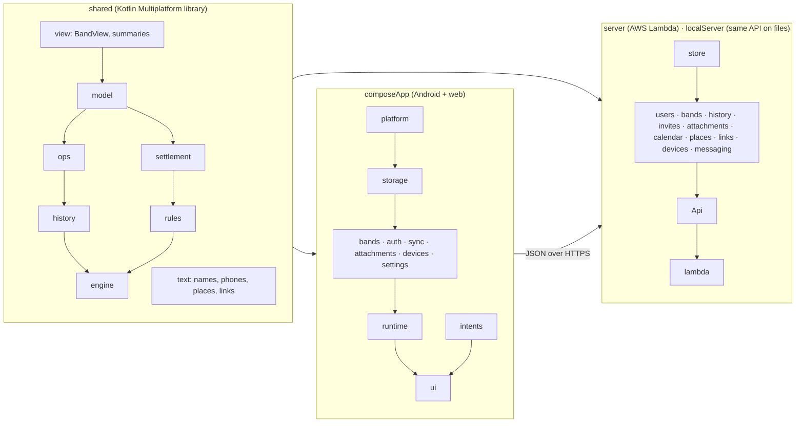

# Architecture

How Kapelusz is built, for someone who has to change it. What the app *does* is in [SPEC.md](SPEC.md); why some
things are the way they are is in [DECISIONS.md](DECISIONS.md); what is known to be wrong or missing is in
[BACKLOG.md](BACKLOG.md).

## 1. The shape in one picture



Three modules carry the logic; two are shells. The arrows are the intended direction; two pairs in `shared` still
refer to each other (`ops` and `history`, `rules` and `settlement`), noted in [BACKLOG.md](BACKLOG.md).

| Module | What it is | Depends on |
|---|---|---|
| `shared` | The data model, the operations, the reducer that applies them, permissions, the settlement maths, the read-only views the screens use. Pure Kotlin, no platform code. | nothing |
| `composeApp` | The app: Compose Multiplatform for Android and the web (Wasm). Offline-first; keeps bands on the device and syncs them. | `shared` |
| `androidApp` | The Android application shell: the Activity, the manifest, Play services. | `composeApp` |
| `server` | The API: one AWS Lambda behind API Gateway, S3 for band state, DynamoDB for the history log. | `shared` |
| `localServer` | The same `Api` on this machine with files instead of S3 and DynamoDB, for development without AWS ([LOCAL_DEVELOPMENT.md](LOCAL_DEVELOPMENT.md)). | `server` |

The one rule that makes the rest hang together: **every change to a band is an `Operation`, applied by the shared
`Engine` on the device and again on the server**. The device applies it to show the result at once; the server applies
it to be the authority. Nothing else edits a band.

## 2. `shared`: the rules, once

```
model/       Band, Event, Cost, Member, Money, …  (@Serializable; the stored and transmitted shape)
ops/         Operation and its groups (EventOp, CostOp, FundOp, RosterOp, …), one file per group
history/     what is stored or sent: OpEnvelope, BandChange (for undo), KapeluszJson (Rejection stays in model/)
engine/      Engine.apply / applyBatch: validation, permission check, the reducers, limits, duplicates by seq
rules/       Permissions (who may do what), Capabilities (what the UI may offer), the predicates screens ask
settlement/  the money maths: who collected what, who paid what, who hands over how much to whom
view/        BandView: indexed lookups and memoised settlements over one Band state; summaries
text/        pure text utilities: names, phone and bank numbers, places, event links
api/         the wire types of the API (requests, responses, error codes) and its limits
```

- A `Band` is a plain value. The reducer returns a new one; nothing is mutated.
- `Engine.applyBatch(band, actor, envelopes)` applies a list of `OpEnvelope`s in order and returns the new band plus,
  per envelope, *accepted*, *rejected* (with a `Rejection` the UI can show) or *duplicate* (a sequence number the band
  already saw from that client). The server and the device call the same function.
- Serialization is pinned: every polymorphic class (operations, rejections, changes) carries an explicit `@SerialName`,
  and `WireFormatTest` holds the JSON of a full band, one envelope per operation type and a history entry. Moving a
  class between packages cannot change what is stored.
- `view/BandView` is built once per band state and answers the screens' questions (a member by id, an event's
  settlement, the fund totals) without recomputation. Screens take settlements from it rather than running the
  calculator; a few ledger helpers (`CostLedger`, `partyOrder`) are still called from the UI ([BACKLOG.md](BACKLOG.md)).

## 3. `composeApp`: the app

```
App.kt, Navigation.kt, AppDialogs.kt    the composition root: App() switches on AppState; the NavHost and its routes
platform/     the Platform interface (store, file cache, Google sign-in, clipboard, sharing, maps, PDF, QR, messages)
              and its Android and web implementations; FakePlatform in the tests
storage/      KeyValueStore: app-private files on Android, IndexedDB on the web, memory in tests
auth/         Session, SessionRepository (tokens, renewal), GoogleAuth, Account (sign in and out)
bands/        LocalBand (base state + unsent operations), BandRepository (memory, flows), BandStore (persistence),
              Changes (dispatch with Undo holds), Membership (join, leave), EventLinkOpener, PlacesLocator
sync/         SyncEngine (when to sync), SyncState (the loop as a state machine), SyncRound (what one sync does),
              ApiClient/ApiTransport (HTTP), HistoryDecoder — see sync/README.md
attachments/  Attachments (files of costs and events), AttachmentUploads (the upload queue)
devices/      DeviceRegistration: the Android device's Firebase token, registered when something relevant changes
settings/     AppSettings and their repository
intents/      AppIntent, IntentInbox, IntentRouter: things arriving from outside (links, shares, messages) routed to screens
runtime/      AppRuntime (the wiring and lifecycle), AppState (the one thing App() switches on)
ui/           screens/, components/, theme/, format/, text/; AppNavigator, Routes, ViewModels, BandSession
util/         newId, nowMillis, today; runSuspendCatching
```

### 3.1 State

`AppRuntime` builds every object in dependency order and exposes one `StateFlow<AppState>`:

```kotlin
sealed interface AppState {
    data object Loading
    data object UpdateRequired                       // the server refused this app version
    data class SignedOut(val everywhere: Boolean)    // after "sign out on all devices", say why
    data class SignedIn(val session: Session, val band: BandState)   // BandState: NoBand / Ready / Unreadable
}
```

`App()` switches on it and nothing else. The platforms call three lifecycle methods on the runtime
(`onForeground`, `onBackground`, `onHidden`) and hand it what arrives from outside (`onMessage`, `onNewToken`, an
intent); the Android background worker calls `syncInBackground`.

### 3.2 A band on the device

A `LocalBand` is the band as the server last gave it (`base`, with its ETag `version`) plus the user's operations the
server has not accepted yet (`pending`). What the screens see is `base` with `pending` replayed on top. Making a change
applies the operation with the shared `Engine` (so a refusal is immediate and identical to the server's), appends the
envelope to `pending`, marks the band dirty, and asks the sync engine to run soon. `BandStore` writes dirty bands to
the `KeyValueStore` in the background and before every push.

Keys in the store: `session`, `band-index-<userId>` (the bands the user has and which is open),
`band-<userId>-<bandId>`, the settings, and `…-backup-<time>` copies written before anything is dropped.

### 3.3 Sync

Operation-based and offline-first: the device pushes operations, never state; the server applies them and answers with
the state it now has, which becomes the new `base`. Pulls use `If-None-Match`. The loop is a pure state machine
(`SyncState`: Stopped, Running, Idle with backoff, Draining for a hidden web tab, Blocked when the user must act), and
one round (`SyncRound`) is create → push in batches → upload files → pull → band list. The full account, with sequence
diagrams, is [composeApp/src/commonMain/kotlin/com/jacekgajek/kapelusz/app/sync/README.md](composeApp/src/commonMain/kotlin/com/jacekgajek/kapelusz/app/sync/README.md).

### 3.4 Screens

Each screen gets a `ViewModel` from its navigation entry and the few services it uses from `BandSession` (the open
band's repository, changes, attachments, settings). Routes are typed (`ui/Routes.kt`); route arguments are strings and
ids, never enums, because the web's navigation cannot parse an enum. Text comes from Compose resources in English and
Polish (`composeResources/values` and `values-pl`).

## 4. `server`: the API

```
Api.kt, Router.kt, Http.kt, ApiSupport.kt, ServerConfig.kt    the request path: routes as a table, Call per request
store/        BlobStore (S3, files, memory), HistoryStore (DynamoDB, files, memory), GeocodeCache; Document<T>;
              StorageKeys and the stored record types
auth/         token verification (Google), sessions and their revocation
users/ bands/ history/ invites/ attachments/ calendar/ places/ links/ devices/ messaging/
              one package per resource: a records or access class over the store, and the handlers over it
lambda/       the API Gateway adapter and SnapStart priming
```

- A request is authenticated, then matched against the route table; the handler gets a `Call` (request, user, path
  parameters, the sender's device) and answers an `HttpResponse`. Two public routes (the calendar feed, event link
  pages) bypass authentication and the app-version gate.
- A band's state is one S3 object, written with a conditional `If-Match`; a push loads it, runs `Engine.applyBatch`,
  writes back, and on a concurrent write starts over (five attempts). `Document<T>` does that dance for every other
  JSON record (users, invites, devices, scheduled deletions).
- Everything that must follow a committed change (invites revoked, event link pointers, attachment files deleted,
  the deletion list, the history entry, the sync message to the other devices, unlinked users' band lists) is
  `BandChanged.after`, called from the four handlers that change a band, in one fixed order.
- Sync messages are Firebase data messages carrying only a band id, to the other members' devices; the sender's own
  device is left out. No user-facing notifications.
- Configuration (`ServerConfig`) and environment variables are read in exactly two places: `lambda/Handler` and
  `localServer`'s `main`. Tests build `Api` with in-memory stores and defaults.

## 5. Tests, and where to look

| Module | What is tested | How |
|---|---|---|
| `shared` | the rules: golden settlements from real spreadsheets, invariants, one reducer test per limit, permissions per operation, the wire format | pure unit tests, `commonTest` |
| `composeApp` | the repository and store (loss scenarios), the sync protocol against a `FakeServer` running the real `Engine`, the state machine as a table, intents, view models | `commonTest`, run as Android host tests on the JVM and in headless Chrome; virtual time throughout |
| `composeApp` | five screen smoke tests: sign-in, no band, an event opens, settings pages, update required | `wasmJsTest`, in headless Chrome (the one target with a composition) |
| `server` | every route through `Api.handle` with in-memory stores, each quota and race, the order of `BandChanged` | `ApiHarness` |
| `localServer` | a few end-to-end requests against the file stores | JUnit |

`./gradlew check compileKotlinMetadata` is what CI runs ([README.md](README.md#test)).

## 6. Conventions a reader can check

- `shared` never imports the app or the server; nothing in `commonMain` names Android or the browser.
- Screens talk to view models, `BandSession` and read-only flows, never to `ApiClient` or `SyncEngine`.
- No DI framework: `AppRuntime` and `Api` are the two places where objects are built, in dependency order.
- No backward compatibility for data on devices: every user is on a current version; stored data is read leniently
  (unknown fields ignored) and an app older than `Api.MIN_APP_VERSION` is told to update.
- The data model and the stored JSON do not change without a `WireFormatTest` update, and the server refuses what it
  does not understand (`UnknownOperation`).
- ktlint and detekt run in `check`; the baselines in `config/detekt/` hold what predates them and are only shrunk.
- A comment explains *what* in place; where it cites the reason for a behaviour it uses the short history citation
  `SPEC.md`'s preface defines (`I5 §7`, `I3 R12`): searching `SPEC.md` for it finds the behaviour, and
  `docs/history/ITERATION_5.md` §7 the discussion. A touched comment loses the citation for an explanation.
