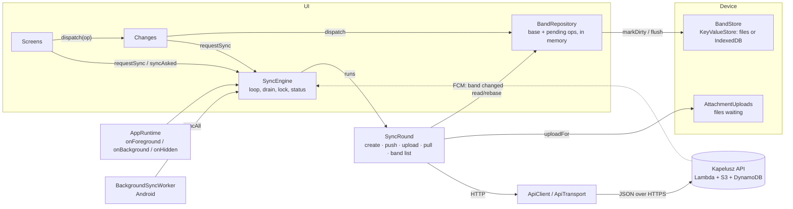
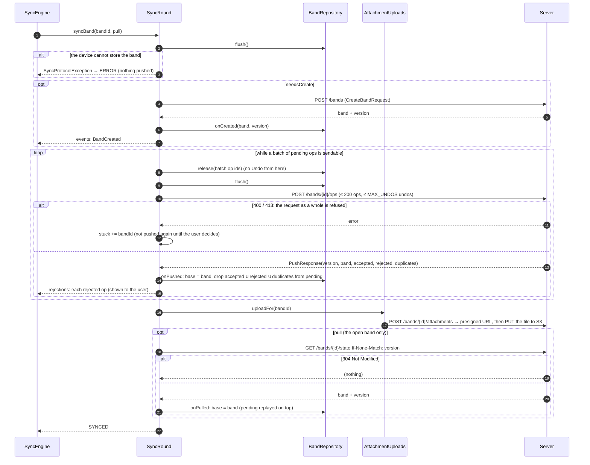
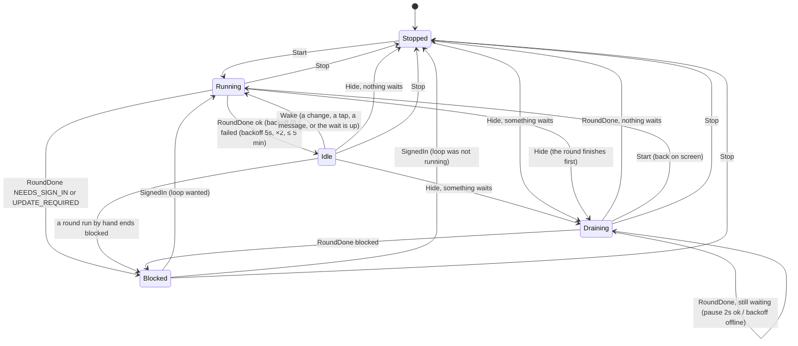
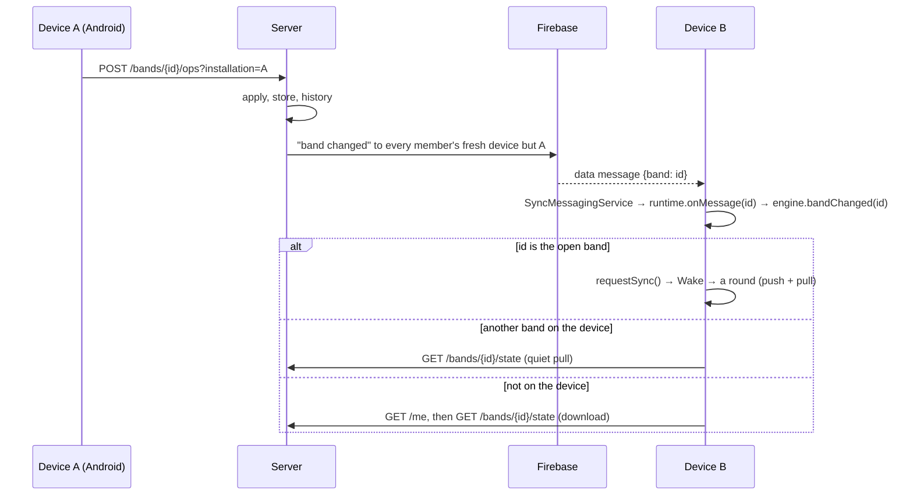

# How sync works

This package keeps a band on the device and on the server the same, while the device may be offline for hours and
several devices edit the same band. It is an **offline-first, operation-based** sync: the app never sends "the band
as it is now"; it sends the operations the user made, and the server applies them with the same rules the app did.

The files, by job:

| File | Job |
|---|---|
| `SyncEngine.kt` | *When* to sync and for which bands: the periodic loop, the web tab's drain, the lock that keeps rounds apart, the status the icon shows, and the few things a user can ask for by hand (leave a band, download one, discard refused changes). |
| `SyncState.kt` | The loop as a pure state machine: `SyncState` × `SyncInput` → (`SyncState`, `Effect`). Tested as a table. |
| `SyncRound.kt` | *What* one sync does for one band: create, push, upload, pull, and keep the band list right. No loop, no lock. |
| `ApiClient.kt`, `ApiTransport.kt`, `SessionApi.kt` | The HTTP side: every request carries the session token, the app version and the Android installation id; a refused token is refreshed once. |
| `ScreenApis.kt` | The small interfaces screens get instead of the whole client. |
| `HistoryDecoder.kt` | Reads the server's history entries, including operations this app version does not know. |

What is stored on the device is `BandRepository` and `BandStore` (in `../data`); the files waiting for upload are
`AttachmentUploads`; the Android device's registration for push messages is `DeviceRegistration`. They are described
here where sync depends on them.



## 1. The model: a base state plus unsent operations

Every band on the device is a `LocalBand`:

```kotlin
data class LocalBand(
    val base: Band,                 // the band as the server last gave it to us
    val version: String?,           // the server's ETag of `base` (null until the band has been on the server)
    val pending: List<OpEnvelope>,  // the user's operations not yet accepted by the server, oldest first
    val clientId: String,           // this device, for the sequence numbers
    val nextSeq: Long,              // the next sequence number this device will use
    val needsCreate: Boolean,       // made offline: the server does not know the band yet
    val holds: Map<Id, Long>,       // op id → until when it is kept back from sending (the Undo snackbar)
    // …
)
```

What the screens show is never stored: it is **replayed** on demand, `base` with every `pending` operation applied on
top (`BandRepository.replay`). An operation that no longer applies on the new base (someone else deleted the cost it
edits, say) is simply skipped in the replay; the server will reject it in the same way when it is pushed.

Making a change (`Changes.dispatch` → `BandRepository.dispatch`):

1. The operation is applied to the *shown* band with the shared `Engine` (the same permission checks and reducers the
   server runs). A refusal comes back as a `Rejection` and nothing is recorded.
2. It is wrapped in an `OpEnvelope(opId, clientId, seq, timestamp, op)`: `opId` is a fresh UUID, `seq` is
   `nextSeq` (then incremented), `timestamp` the device's clock.
3. The envelope is appended to `pending`, the band is marked dirty (written to the store in the background), and the
   engine is asked to sync soon (`requestSync`).

Two things follow from this shape:

- **Idempotent pushes.** The server keeps, per band and per device (`clientId`, which it prefixes with the user id so
  two users' devices never collide), the last `seq` it applied. A push
  that arrives twice (the answer was lost) is recognised by `seq` and answered as a *duplicate*; a rejection it gave
  before is repeated, because the device may never have seen it.
- **Nothing is sent that is not on disk.** `nextSeq` lives in the stored `LocalBand`; if a push went out and the app
  crashed before the new `nextSeq` was written, the next operation would reuse a sequence number and be dropped as a
  duplicate. So the round *flushes the store and refuses to push if the flush fails* (`storedOrStop`), and again before
  every batch.

### Undo holds

An operation shown with an Undo snackbar (`Changes.dispatchHeld`) is recorded with a **hold**: `holds[opId] = now +
timeout`. The push never sends from the first held operation onwards (later ones may build on it), so Undo can still
**withdraw** it, dropping it from `pending` as if it was never made. Once the snackbar is gone, `release` lets it go;
past its time a hold no longer counts (the app may have been closed). What is about to be sent is released first, so
it can never be withdrawn after the server has it.

## 2. One round: `SyncRound.syncBand`

A round works on one band at a time, so a problem with one band never blocks the others:



Details worth knowing:

- **Create first.** A band made offline has `needsCreate`; the server gets `CreateBandRequest` with the ids the device
  chose (ids are the client's, so an offline band keeps them). A retried create of one's own band is fine; a foreign
  id conflicts.
- **Batches.** `batchOf(pending, holds, now)` takes at most `BATCH_SIZE` (200) operations from the front, stops at the
  first operation still held, and takes no more undos than the server accepts in one push. The loop runs until nothing
  sendable is left.
- **The server's answer** (`PushResponse`) carries the band *as the server has it now*, its `version` (an ETag), and
  for each pushed op whether it was `accepted`, `rejected` (with a `Rejection`) or a `duplicate`. The repository takes
  the server's band as the new `base` and drops every op in those three sets from `pending`; what remains (ops the
  server never saw, e.g. a batch that failed on the way) is replayed on top and sent next time. If the server processed
  *none* of the batch, that is a protocol error (the push is not making progress), not something to retry at once.
- **Refused as a whole** (HTTP 400 `too_many_devices`: this user already pushes from 50 devices to this band; 413
  `band_too_large`, which today's server no longer sends, as it refuses oversized operations one by one instead): the
  same push would be refused again, so the band becomes *stuck*: its push is skipped until the user discards the unsent changes
  (`SyncEngine.discardStuck`, which keeps a backup first) or the app starts again. Pulls go on. The status shows an
  error while any stuck band is on the device.
- **Uploads after the push.** A file can only be uploaded once the server has its `AddAttachment` operation, so
  `uploadFor` runs after the push and skips files whose operation is still pending. It asks the server for a presigned
  URL (`POST /bands/{id}/attachments`) and PUTs the file to S3 directly; 412 means an earlier attempt succeeded. Only the
  server's explicit "exists" or "not found" drops a file after a failed request; any other failure keeps it, as the
  device's copy is the only one. A file is also let go when it can no longer be uploaded at all: the band left the
  device, the attachment is no longer in the band's base, or the file's bytes are missing.
- **Pull only for the open band.** Other bands are only pushed in the periodic loop; their state is refreshed when
  they are opened, when a message says they changed, or by `syncAll`.

### The band list and lost access

After the bands, unless the round ended offline or blocked, it asks `GET /me` and compares the server's list with the
device's (`checkBandList`):

- bands the server lists that the device does not have are only listed (downloaded on demand or by `syncAll`);
- bands the device has that the server no longer lists (not ones created offline) are synced once more, which makes the
  server say why: `band_not_found` (the user was removed) or `band_deleted`. The band is then let go of
  (`BandRepository.loseAccess`): its unsent changes are kept under a backup key, it is removed from the device, and
  `lostAccess` tells the UI, which says so. Any *other* 404 never removes a band.

### What a failure means

`SyncRound.classify` turns a throwable into the status the icon shows:

| Failure | Status | Then |
|---|---|---|
| `update_required` from the server | `UPDATE_REQUIRED` | the loop is blocked until the app is updated (which restarts it); `ApiSignal.UpdateRequired` switches the whole app to the update screen |
| `NeedsSignInException` (no token, or a refreshed one still refused) | `NEEDS_SIGN_IN` | the loop is blocked until the user signs in again |
| any other `ApiException`, a protocol error, unreadable JSON | `ERROR` | retried with backoff |
| anything else (no network, DNS, a browser "Failed to fetch") | `OFFLINE` | retried with backoff |

Blocking matters: while waiting for the user to sign in again, retrying would only repeat silent token renewals (and on
the web possibly Google prompts) while hiding the "sign in again" state.

## 3. The scheduler: `SyncEngine` and `SyncState`

The engine decides *when* rounds run. Its loop is a state machine (`SyncState.kt`): every input goes through the pure
`reduce(state, input, rules)`, which returns the next state and an `Effect`; `SyncEngine.send` applies the effect
(launch a round, launch a timed wait, cancel). The rules it is given say whether something waits to be sent, whether
the server sends messages, and the intervals.



The states:

- **Stopped**: not on screen (Android), or never started. Nothing runs.
- **Running**: a round is under way. One at a time: a wake while one runs is not lost, the loop looks again right after
  it anyway (`runLock` also serialises rounds against the by-hand operations).
- **Idle(backoff)**: between rounds, a wait job runs. The wait is `interval` (30 s) after a good round, or
  `MESSAGED_INTERVAL` (5 min) when the server sends messages about changes, or the `backoff` after a failed one: 5 s,
  doubling to at most five minutes, reset by a good round. The wait is *wakeable*: a `requestSync()` ends it early,
  followed by a one-second `DEBOUNCE` so quick taps make one round.
- **Draining(backoff, running)**: the web tab was hidden (`onHidden`). What waits to be sent goes first, in rounds two
  seconds apart while they succeed (a held operation counts as waiting, so the drain polls every two seconds until the
  hold is over), with backoff while a round fails, then the loop stops.
  Nothing hurries a hidden tab: its waits are not wakeable. Shown again, `Start` turns the drain's round into the
  loop's first.
- **Blocked(why, loopWanted)**: no round until the user acts. `loopWanted` remembers whether the loop was running (or
  `Start` came meanwhile), so signing in again either resumes the loop at once or leaves it stopped.

What feeds the machine:

| Input | From |
|---|---|
| `Start` | `AppRuntime.onForeground()`: Android's activity started, the web tab shown, after `load()` with a session, after sign-in |
| `Stop` | `AppRuntime.onBackground()`: Android's activity stopped (a background job sends what waits); signing out |
| `Hide` | `AppRuntime.onHidden()`: the web tab hidden, or opened in the background |
| `Wake` | the wait job: the time is up, or `requestSync()` (every local change, the sync icon, a message about the open band) |
| `RoundDone(status, waiting)` | every round, also one run by hand (`syncNow`) and `syncAll` when it finds the app outdated |
| `SignedIn` | `resumeAfterSignIn()`: the sign-in-again dialog, or a new sign-in |

`bandChanged(bandId)` (a push message, see below) is not an input: for the open band it is a `requestSync()`; for
another band on the device it runs `syncBand(pull = true)` for that band alone under the lock (its unsent changes and
files go too, and `band_not_found` lets it go); for a band not on the device it asks `GET /me` and downloads it if listed. It is ignored while the loop is not running, as coming back to the screen
syncs anyway.

### Rounds the loop does not own

- `syncNow()` runs one round by hand (the history screen does, before reading the server's log). Its outcome still goes
  through `RoundDone`: what blocks every round (sign in again, update) blocks the loop too; otherwise the loop goes on.
- `syncAll()` is the **background** round (Android's `BackgroundSyncWorker`, scheduled when the app leaves the screen
  with unsent work; and an event link looking for its band): every band the user belongs to is pushed and pulled, bands
  not on the device are downloaded without opening them, the store is flushed. It never shows "sign in again": in the
  background a token cannot be renewed interactively, and the foreground would then stop syncing although its own
  silent renewal would work.
- `leave(bandId)` sends the band's unsent changes and files first (releasing holds), then asks the server to unlink the
  account, then forgets the band; it throws `LeaveBlocked` when they cannot be sent. Under the lock, so no round meets
  a band already left and reports it lost.
- `discardStuck(bandId)` drops the refused unsent changes (backup first), lets the band be pushed again, and pulls it.
- `download(bandId)` fetches and opens a band the user belongs to that is not on the device yet.

### What the icon shows

`status` is the *display*, never a guard: `SYNCING` while something is actually sent, or right after the user tapped the
icon (a round that only checks for news keeps the icon as it is, instead of blinking it every 30 s), then the round's
result; `ERROR` also while any
band's push is stuck. The guards are the state machine (`Blocked`).

## 4. Triggers from outside: messages and lifecycle



- Every request carries `installation=<id>` (Android only), so the server leaves the sender's own device out.
- `DeviceRegistration` registers the device's Firebase token whenever what the server keeps it for changes (signed in,
  in a band or not, a band the server now has, a new token) and again when the app comes to the screen after a failed
  attempt or a day later; the server's answer says whether messages will come, which `SyncEngine.messaged(on)` turns
  into the five-minute interval. The web has no channel: it keeps the 30-second interval.
- A message can be lost (Firebase, the server could not read a member's devices): the loop still looks for news itself
  every five minutes.

## 5. The transport

`ApiTransport` sends every request to the API's base URL with the `appVersion` and `installation` query parameters
and the bearer token; `ApiClient` adds the token on top (`send`):

1. Ask the session repository for a valid token (a Kapelusz session token, renewed while it is used; Google is asked
   only when there is no usable session).
2. On **401**, ask again with the refused token named (so a concurrent renewal is not thrown away) and retry **once**;
   a second 401 is `NeedsSignInException`.
3. The error body `sessions_revoked` ("sign out on all devices", here or elsewhere) is never retried: it raises
   `ApiSignal.SessionsRevoked` and the app signs out. `update_required` raises `ApiSignal.UpdateRequired`.

The signals are a `SharedFlow` the runtime subscribes to before anything can emit.

## 6. Persistence

- `BandRepository` keeps the bands in memory and marks what changed; `BandStore` writes dirty bands and the index soon
  after each change, **now** when the sync asks (`flush`), and again later when the device was full. A change made
  during a write is written in another pass rather than counted as saved.
- Before anything is lost (access lost, changes discarded, an unreadable band) a backup is written under its own key,
  so a mistake can be undone by hand.
- `schema` on `LocalBand` records the data format a band was stored with: an older app drops fields it does not know
  but keeps the server's `version`, so the server would keep answering 304; a band stored with an older format is
  downloaded in full once.

## 7. Server side, in one paragraph

`POST /bands/{id}/ops` loads the band, runs `Engine.applyBatch` with the pushed envelopes as the user (the same
reducers and role rules), and writes the band back with a conditional write: if another device wrote meanwhile, the
whole batch is applied again on the new state (at most five attempts, then `409 busy`). Then, in one place (today in
the handler, soon `BandChanged.after`): invites
of members unlinked or gone are revoked, event link pointers follow the events, files of removed attachments are
deleted, the deletion list is updated, the history entry is appended, the sync message goes out to everyone in the band
before or after (but the sender's device), and users whose account was unlinked lose the band from their list. The
answer is the band as stored, its ETag, and the fate of each operation. The band's size is capped: operations that
would grow it past the limit are refused one by one, so the rest goes through and the device's queue does not get stuck.

## 8. Where to look for a behaviour

| Question | Place |
|---|---|
| Why did my change not reach the server? | `SyncRound.pushBand` (held? stuck? flush failed?), `SyncEngine.stuck`, `rejections` |
| Why does the icon say offline / error / sign in? | `SyncRound.classify`, `SyncEngine.runRound` (`shown`) |
| When does the next round run? | `SyncState.kt`: `roundDone` and `SyncRules.waitAfter`; `SyncEngine.waitThenRun` |
| What happens when the tab is hidden / the app goes to the background? | `SyncState.hide`, `AppRuntime.onHidden/onBackground`, `BackgroundSyncWorker` |
| Why was a band removed from my device? | `SyncRound.syncBand` (the `gone` branch), `checkBandList`, `BandRepository.loseAccess` |
| How are two devices' edits merged? | there is no merge: operations are applied in the order the server receives them, `Engine.applyBatch`; the device replays its pending ops on the server's state |
| Tests | `SyncEngineTest` (the protocol and the loop against a fake server), `SyncStateTest` (the table), `BandRepositoryTest`, `AttachmentsTest`, `DeviceRegistrationTest` |
